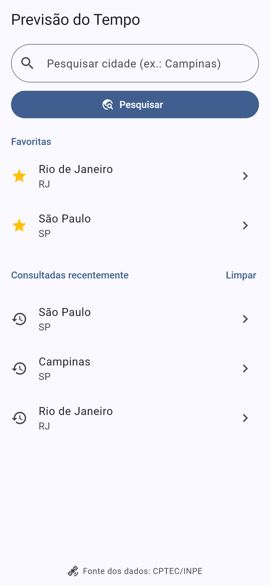
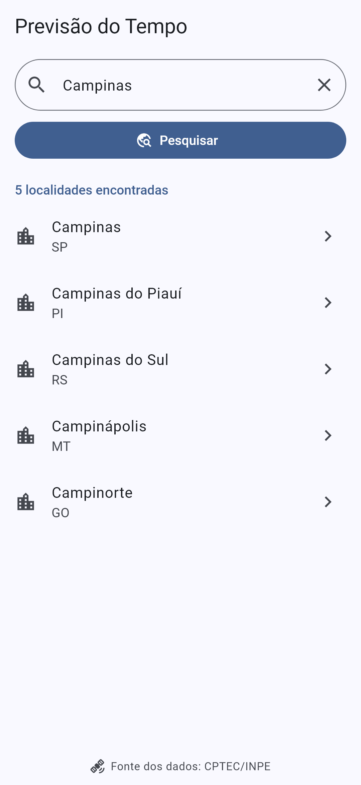
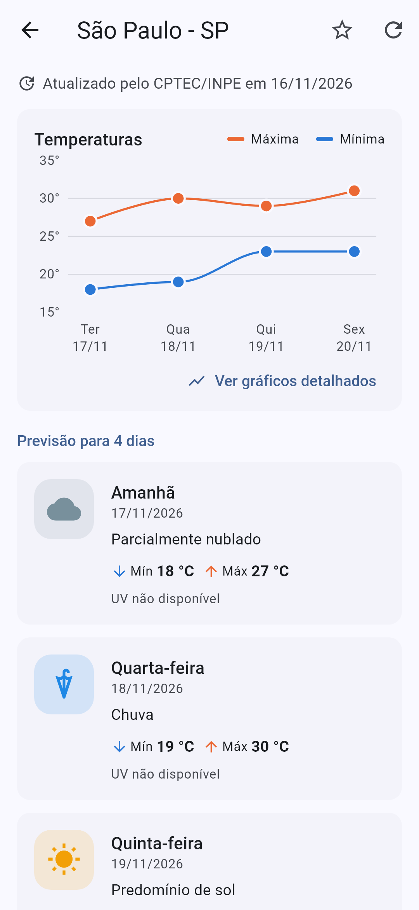
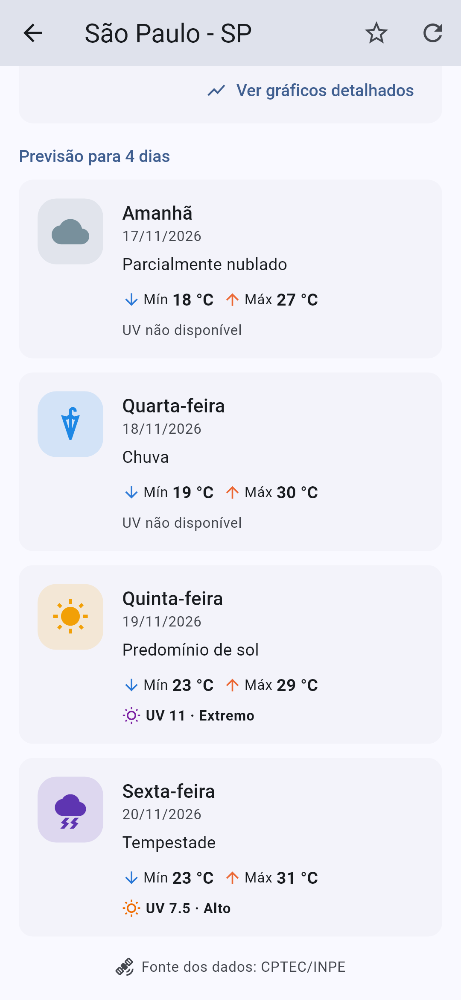
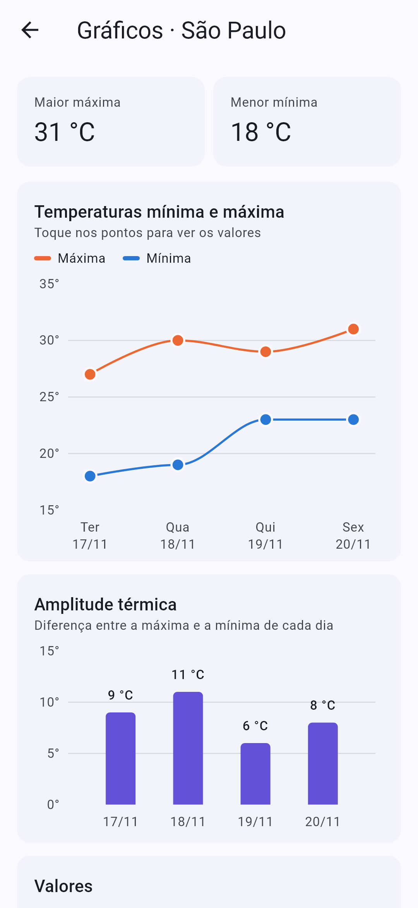
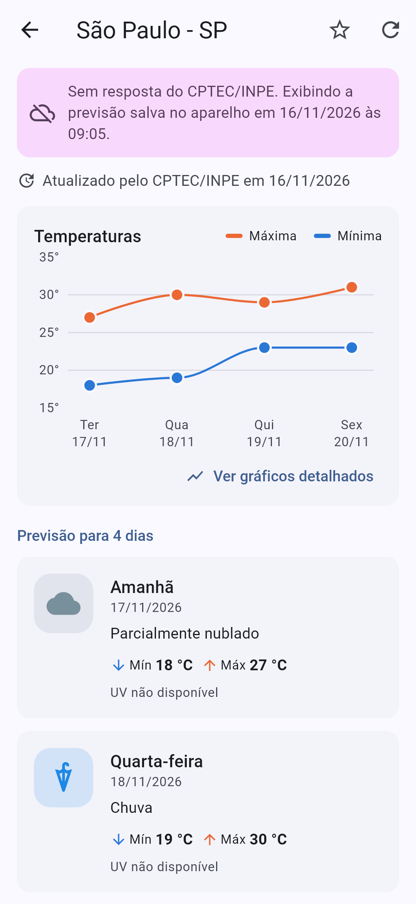
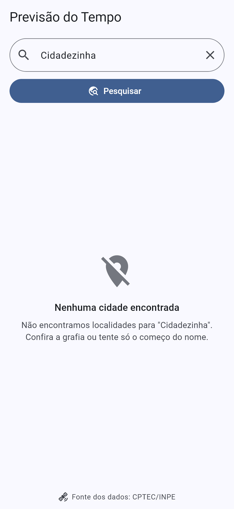
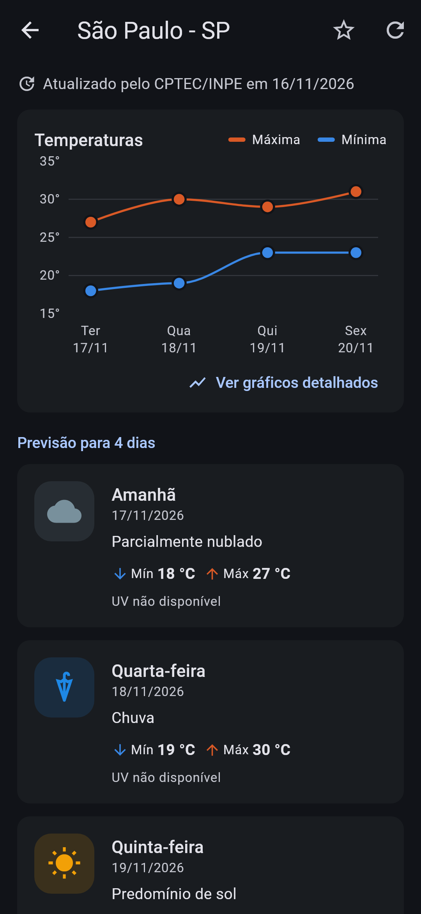

# Previsão do Tempo

[](https://github.com/Carlos-Santo/Previsao-do-Tempo/actions/workflows/build-apk.yml)

📱 **Baixar o APK para Android:** [última versão](https://github.com/Carlos-Santo/Previsao-do-Tempo/releases/latest)

Aplicativo em **Flutter** para consultar a previsão do tempo de cidades brasileiras com os dados do **CPTEC/INPE**.

Atividade 2 de Programação para Dispositivos Móveis I (Fatec, Prof. Arley).

> **Fonte dos dados:** [CPTEC/INPE](http://servicos.cptec.inpe.br/XML/), o Centro de Previsão de Tempo e Estudos Climáticos do Instituto Nacional de Pesquisas Espaciais.

---

## Funcionalidades

### Pesquisa de cidades
- O usuário digita o nome (ou o começo do nome) da cidade e o app consulta o serviço `listaCidades` do CPTEC, enviando o termo no parâmetro `city`.
- Cada resultado mostra o **nome da cidade** e a **UF**. Ao tocar, abre a previsão daquela localidade.
- A consulta de previsão usa o **código (`id`) retornado pelo próprio serviço**.
- Quando nada é encontrado, aparece a mensagem *"Nenhuma cidade encontrada"*.

### Previsão para quatro dias
- Consulta o serviço `cidade/{código}/previsao.xml` e mostra **todos os dias retornados**.
- Para cada dia, o app exibe:
  - data da previsão (com "Amanhã" ou o dia da semana);
  - temperaturas **mínima e máxima em °C**;
  - **descrição** da condição do tempo, com as 40 siglas do CPTEC (`pn`, `c`, `ps`, `t`…) convertidas em texto conforme a [tabela oficial](http://servicos.cptec.inpe.br/XML/#condicoes-tempo);
  - **ícone** que representa a condição (sol, nuvem, chuva, tempestade, nevoeiro, geada…);
  - **índice ultravioleta** com sua classificação (Baixo, Moderado, Alto, Muito alto, Extremo), quando disponível.
- Mostra também a **data de atualização** informada pelo CPTEC.

### Gráficos
- Na tela de previsão, um gráfico de linhas mostra as temperaturas mínima e máxima dos quatro dias.
- O botão **"Ver gráficos detalhados"** abre outra tela com:
  - o gráfico de linhas ampliado (tocar num ponto mostra o valor);
  - um gráfico de barras com a **amplitude térmica** (máxima − mínima) de cada dia;
  - os destaques "maior máxima" e "menor mínima";
  - uma tabela com todos os valores.

### Favoritas e histórico
- A estrela na barra superior adiciona ou remove a cidade das **favoritas**.
- A tela inicial lista as favoritas e as **últimas 8 cidades consultadas**, com um botão para limpar o histórico.

### Atualização e tratamento de erros
| Situação | Comportamento |
|---|---|
| Atualizar a previsão | Botão ⟳ na barra superior ou gesto de puxar a tela para baixo. |
| Consulta em andamento | Indicador de carregamento (circular ou barra no topo, durante a atualização). |
| Nenhuma cidade encontrada | Mensagem informando o termo pesquisado. |
| Sem internet ou tempo esgotado (15 s) | Mensagem *"Verifique sua conexão"* e botão **Tentar novamente**. |
| Serviço indisponível (HTTP 5xx, 404…) | Mensagem com o código do erro e botão **Tentar novamente**. |
| Limite de consultas do CPTEC (HTTP 429) | Pede para aguardar um instante. |
| Resposta inválida (não é XML ou formato inesperado) | Mensagem de resposta inválida, sem fechar o app. |
| Sem previsão para a localidade | Mensagem *"Não há previsão disponível"*. O CPTEC devolve os campos com o texto `null` nesse caso. |
| Campos ausentes, vazios ou `null` | O campo aparece como `--`, "não informado" ou "UV não disponível", e o restante da tela continua funcionando. |
| Falha de rede com previsão salva | Exibe a última previsão salva no aparelho, com um aviso e a data e hora em que foi salva. |

O CPTEC/INPE aparece como fonte dos dados no rodapé de todas as telas e na data de atualização.

---

## Capturas de tela

| Tela inicial (favoritas e histórico) | Resultado da pesquisa | Previsão |
|:---:|:---:|:---:|
|  |  |  |

| Dias da previsão (ícones e UV) | Gráficos detalhados | Sem conexão (previsão salva) |
|:---:|:---:|:---:|
|  |  |  |

| Nenhuma cidade encontrada | Tema escuro |
|:---:|:---:|
|  |  |

> As capturas são geradas pelo teste [`test_capturas/capturas_test.dart`](test_capturas/capturas_test.dart), que renderiza as telas do app em tamanho de celular (1080×2340). Ele usa respostas de exemplo no mesmo formato XML do CPTEC (alguns dias com índice UV, para mostrar esse campo). Para gerar de novo: `flutter test --update-goldens test_capturas`.

---

## Instalar no celular (Android)

O APK é gerado automaticamente pelo GitHub Actions ([`.github/workflows/build-apk.yml`](.github/workflows/build-apk.yml)). A cada push, o workflow roda a análise estática e os testes e depois compila o APK. Quando o push é no `main`, ele também publica uma **Release** com o arquivo.

1. No celular, abra **[Releases → última versão](https://github.com/Carlos-Santo/Previsao-do-Tempo/releases/latest)**.
2. Em **Assets**, toque em `previsao-do-tempo.apk` para baixar.
3. Abra o arquivo baixado. Se o Android pedir, permita **"Instalar apps desconhecidos"** para o navegador ou o gerenciador de arquivos e toque em **Instalar**.
4. Se o Google Play Protect mostrar um aviso, toque em **Mais detalhes → Instalar mesmo assim**. O aviso aparece porque o app não vem da Play Store.

> O APK é assinado com uma chave de desenvolvimento gerada a cada build. Para instalar uma versão mais nova, pode ser preciso **desinstalar a anterior** primeiro.

Requer Android 7.0 ou mais recente e conexão com a internet na primeira consulta de cada cidade.

---

## Como executar

### Pré-requisitos
- [Flutter](https://docs.flutter.dev/get-started/install) 3.32 ou mais recente (Dart 3.8+). O projeto foi desenvolvido com o Flutter 3.47.
- Um emulador Android, um celular Android com depuração USB ou um simulador iOS (no macOS).

### Passos
```bash
git clone https://github.com/Carlos-Santo/Previsao-do-Tempo.git
cd Previsao-do-Tempo
flutter pub get
flutter run
```

Para gerar o APK: `flutter build apk --release` (o arquivo fica em `build/app/outputs/flutter-apk/`).

### Rodar no navegador (opcional)
O serviço do CPTEC não envia cabeçalhos CORS, então o navegador bloqueia as requisições na versão web. Para testar sem emulador, abra o Chrome com a verificação desativada (só em desenvolvimento):
```bash
flutter run -d chrome --web-browser-flag "--disable-web-security"
```

### Testes
```bash
flutter analyze
flutter test
```
São 31 testes automatizados, que cobrem:
- a leitura do XML (acentos em ISO-8859-1, campos `null`, campos ausentes, XML malformado);
- o cliente HTTP (URLs, códigos de erro, falta de conexão, tempo esgotado);
- a persistência local;
- o fluxo das telas (pesquisa → previsão → gráficos, mensagens de erro e modo sem conexão).

---

## Bibliotecas utilizadas

| Biblioteca | Uso |
|---|---|
| [`http`](https://pub.dev/packages/http) | Requisições HTTP ao serviço do CPTEC/INPE. |
| [`xml`](https://pub.dev/packages/xml) | Leitura das respostas em XML. |
| [`shared_preferences`](https://pub.dev/packages/shared_preferences) | Persistência local (favoritas, histórico e previsões salvas). |
| [`fl_chart`](https://pub.dev/packages/fl_chart) | Gráficos de linhas (temperaturas) e de barras (amplitude térmica). |
| `flutter_test`, [`flutter_lints`](https://pub.dev/packages/flutter_lints), [`shared_preferences_platform_interface`](https://pub.dev/packages/shared_preferences_platform_interface) | Testes e análise estática (só em desenvolvimento). |

Ícones: Material Icons, que já vêm com o Flutter. Navegação: `Navigator` com `MaterialPageRoute`, também do próprio Flutter.

---

## Estratégia de persistência local

A persistência usa o **`shared_preferences`** pela API `SharedPreferencesAsync`. É um armazenamento chave/valor nativo de cada plataforma: `SharedPreferences`/DataStore no Android, `NSUserDefaults` no iOS e `localStorage` na web. Os dados são guardados como **JSON** e tudo passa pela classe [`ArmazenamentoLocal`](lib/services/armazenamento_local.dart).

| Chave | Conteúdo | Para que serve |
|---|---|---|
| `favoritas` | Lista de cidades (`id`, `nome`, `uf`) em ordem alfabética | Seção "Favoritas" da tela inicial e estrela na tela de previsão. |
| `historico` | Últimas 8 cidades abertas, a mais recente primeiro e sem repetição | Seção "Consultadas recentemente". |
| `previsao_<id>` | A última previsão recebida da cidade, com data e hora em que foi salva | Exibida quando o CPTEC não responde (sem internet, serviço fora do ar, resposta inválida). |

Como funciona:
- **Gravação:** a cada consulta bem-sucedida, a previsão da cidade é salva e substitui a anterior. Respostas sem previsão não apagam a cópia salva.
- **Leitura:** quando a consulta falha, o app procura `previsao_<id>`. Se existir, mostra a previsão com o aviso *"Exibindo a previsão salva no aparelho em dd/mm/aaaa às hh:mm"*. Se não existir, mostra a mensagem de erro com o botão **Tentar novamente**.
- **Robustez:** se algum valor salvo estiver corrompido ou incompleto, ele é tratado como inexistente e o app continua funcionando.

Escolhi o `shared_preferences` porque os dados são pequenos (poucas cidades e uma previsão de 4 dias por cidade) e não exigem consultas relacionais. Um banco SQLite seria mais complexo do que o necessário aqui.

---

## Serviço utilizado

| Consulta | Endereço |
|---|---|
| Localidades | `https://servicos.cptec.inpe.br/XML/listaCidades?city={nome}` |
| Previsão de 4 dias | `https://servicos.cptec.inpe.br/XML/cidade/{código}/previsao.xml` |

Observações sobre o serviço:
- As respostas vêm em **ISO-8859-1**. O app decodifica como Latin-1 para os acentos aparecerem corretamente (ex.: "São Paulo das Missões").
- A busca é por prefixo: "rio" retorna "Rio Acima", "Rio Bonito" etc.
- Para um código inexistente, o serviço responde HTTP 200 com todos os campos `null`. O app trata isso como "sem previsão disponível".
- O índice UV vem como `0.0` quando o CPTEC não tem o dado para a localidade. O app mostra "UV não disponível" nesse caso.

---

## Estrutura do projeto

```
lib/
├── main.dart                        # App, tema claro/escuro
├── models/
│   ├── cidade.dart                  # Localidade (id, nome, UF)
│   └── previsao.dart                # Previsão da cidade e de cada dia
├── services/
│   ├── cptec_service.dart           # Requisições HTTP e tratamento de erros
│   ├── cptec_parser.dart            # Leitura do XML (codificação, campos nulos)
│   ├── cptec_exception.dart         # Tipos de falha e mensagens
│   └── armazenamento_local.dart     # Persistência com shared_preferences
├── screens/
│   ├── busca_screen.dart            # Pesquisa, favoritas e histórico
│   ├── previsao_screen.dart         # Previsão de 4 dias
│   └── grafico_screen.dart          # Gráficos detalhados e tabela
├── utils/
│   ├── condicoes_tempo.dart         # Siglas do CPTEC → descrição, ícone, cor; categorias de UV
│   └── formatadores.dart            # Datas e temperaturas em português
└── widgets/                         # Cartão do dia, gráficos, mensagens, rodapé de fonte
test/                                # Testes de parser, serviço, persistência e telas
test_capturas/                       # Gera as capturas de tela do README
docs/capturas/                       # Capturas de tela
```
